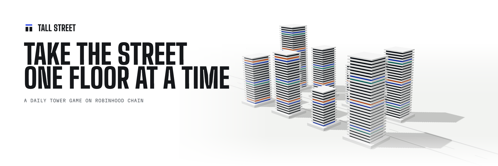

Tall Street is a daily tower game on Robinhood Chain. Crews stack floors on towers tied to stock tokens, each stock decides what its tower is worth, and at 20:00 UTC the most valuable street takes the pot.

### How a round works

- A round runs from 20:00 UTC to 20:00 UTC. Every tower starts empty.
- A floor costs 0.001 ETH, or 0.002 ETH in the final hour, from 19:00 to 20:00 UTC.
- The crew with the most floors on a tower holds it. A draw stays with whoever got there first.
- Each tower has a weight that follows its stock token: 1 + 10 × the move since the open, kept between 0.5 and 1.5.
- At the close, the crew with the highest street value wins. 90% of the pot goes to that crew, split by the floors each member placed. 10% goes to Tall Street.

### Status

- **Website and demo round:** built. A full round on the real clock and real stock prices, with simulated rival crews and demo ETH.
- **Game contracts:** in development. Their source will be published on this profile, and their addresses verified, before any floor is placed with real ETH.
